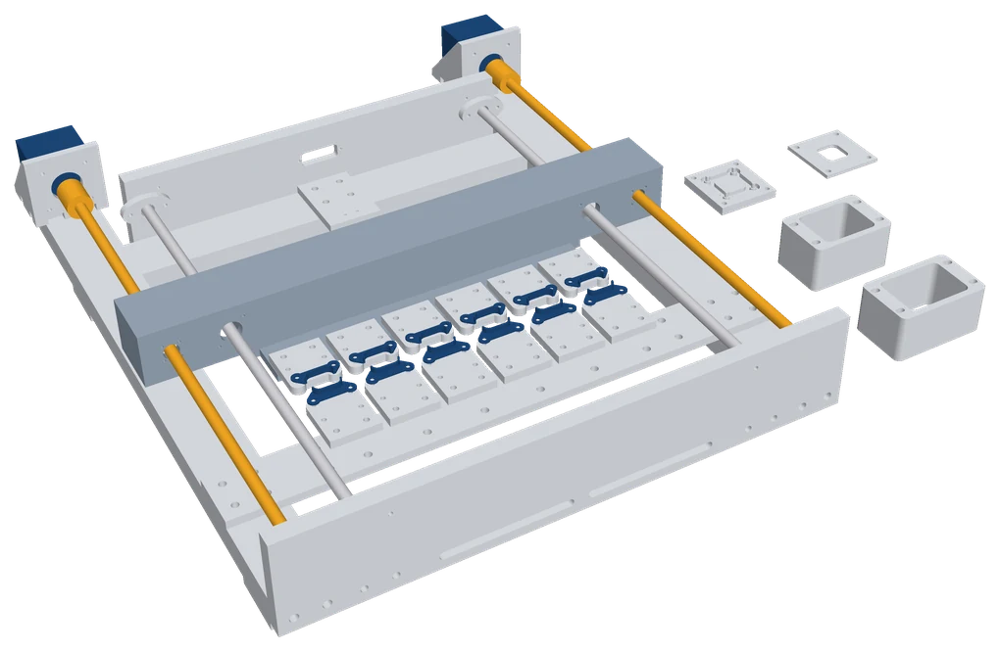
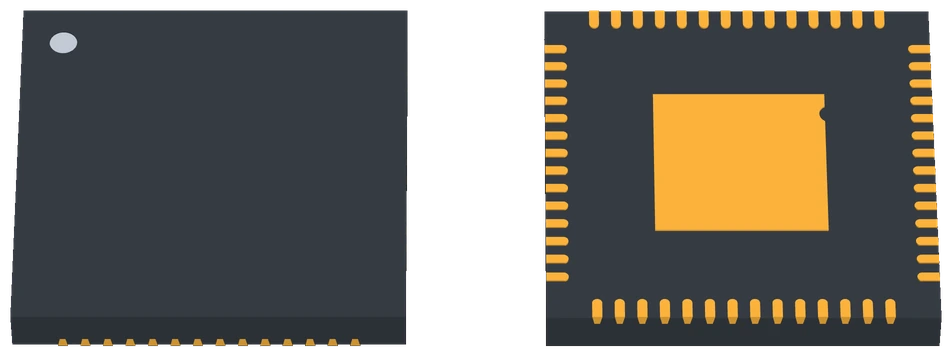
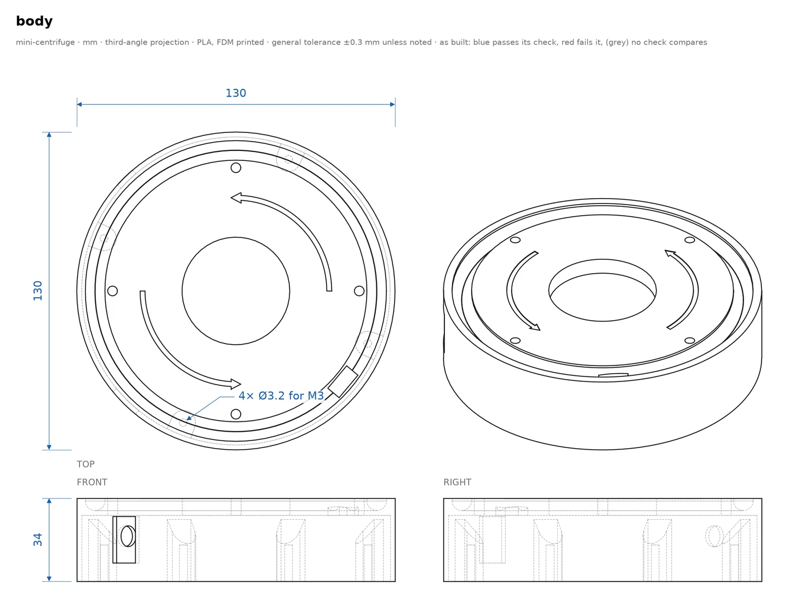

<p align="center">
  
</p>

<h1 align="center">cad-reverse-engineer</h1>

<p align="center">
  <b>Turn a paper, patent or datasheet into parametric CAD,<br>with every dimension traced to where it came from.</b>
</p>

<p align="center">
  <a href="#try-it">Try it</a> · <a href="#use-it-on-your-own-documents">Use it on your own documents</a>
</p>

<table align="center">
<tr>
<td align="center" valign="bottom" width="50%"><a href="examples/compact-sspg"></a><br><b><a href="examples/compact-sspg">Planetary gearbox</a></b><br><sub>from a paper and the authors' meshes</sub></td>
<td align="center" valign="bottom" width="50%"><a href="examples/centrifuge"></a><br><b><a href="examples/centrifuge">Benchtop centrifuge</a></b><br><sub>from a paper and the authors' STEP files</sub></td>
</tr>
<tr>
<td align="center" valign="bottom"><a href="examples/cell-stretcher"></a><br><b><a href="examples/cell-stretcher">Cell stretcher</a></b><br><sub>from a paper and the authors' cut sheets</sub></td>
<td align="center" valign="bottom"><a href="examples/rp2040-qfn56"></a><br><b><a href="examples/rp2040-qfn56">RP2040 chip package</a></b><br><sub>from its datasheet</sub></td>
</tr>
</table>

Published hardware rarely comes with CAD you can edit. Give your coding agent the documents instead. It rebuilds the object, checks the geometry against what they state, and shows you every dimension it had to propose.

## What you get

- **CAD you can change.** Every dimension is a named parameter in `params.yaml`. Edit one and rerun the command under [Try it](#try-it) to get new STEP files for SolidWorks, Fusion, Onshape or FreeCAD. To change a number the documents print, mark it `proposed`. Until you do, or if any edit fails a check, the status says NOT VERIFIED.
- **A drawing of each part.** Three views and an isometric one, with checked dimensions at their as-built values.
- **A mechanism that moves.** When the model has joints, it exports to the MuJoCo simulator as a kinematic model, with its gear ratios and lead screws.
- **A report you can audit.** Each dimension is traced to a quote, a figure or a released file, or marked as proposed, with the questions that would settle what is open.
- **A plan to make it.** How each part is made, what to buy and how it goes together.

## Try it

With [uv](https://docs.astral.sh/uv/) installed, rebuild a finished example and check it against its paper and the authors' STEP files:

```bash
git clone https://github.com/Vini-41/cad-reverse-engineer
cd cad-reverse-engineer
uvx --python '>=3.12,<3.15' cadrev==0.3.0 check examples/centrifuge
```

```
VERIFIED: 0 errors, 0 warnings, 27/27 checks pass
```

The first run installs about 1.3 GB of CAD libraries and takes a minute or more. After that it takes about 30 seconds. Open `assembly.step` and `report.md` from `examples/centrifuge/build/`. Of the model's 133 parameters, 95 rest on the sources and the other 38 on proposed values, listed with the questions that would settle them.

<p align="center">
  
  <br>
  <sub>The centrifuge body's drawing, with its checked overall dimensions and M3 hole callout.</sub>
</p>

## Use it on your own documents

Install the plugin in your coding agent. The `cadrev` CLI it runs needs [uv](https://docs.astral.sh/uv/).

<details open>
<summary><b>Claude Code</b></summary>

```
/plugin marketplace add Vini-41/cad-reverse-engineer
/plugin install cad-reverse-engineer@cad-reverse-engineer
```

</details>

<details>
<summary><b>Codex</b></summary>

```
codex plugin marketplace add Vini-41/cad-reverse-engineer
codex plugin add cad-reverse-engineer@cad-reverse-engineer
```

The CLI downloads its dependencies, so allow network access in `~/.codex/config.toml`:

```toml
[sandbox_workspace_write]
network_access = true
```

</details>

<details>
<summary><b>Any agent that reads skills</b></summary>

```
npx skills add Vini-41/cad-reverse-engineer --skill '*'
```

</details>

Then give it the documents and ask:

```
Reverse-engineer the gripper in this paper
```

Three skills take it from there:

1. **`noob` reads the documents.** It shows what they state and what they leave open, has you confirm what it read off the figures, and asks four things: metric or US, the material, whether to keep the design as shown or only its function, and whether to build only what the documents settle.
2. **`build-model` builds and checks the CAD,** proposing what the documents leave open unless you chose to build only what they settle.
3. **`ask-machinist` reviews the design you accept** as the person who has to make it, then writes the plan.

`noob` and `build-model` each end by naming the line to run next. Start a fresh session and run it: the project's files carry everything across.

Built for Fable 5.2, and [benchmarked](docs/benchmark.md) across Anthropic's and OpenAI's frontier models on a version before 0.3.0.

## How it works

```
Documents ──▶ Ledger ──▶ Params ──▶ Model ──▶ Checks ──▶ Report
    │                                           ▲
    └─────── compared with the documents ───────┘
```

- **The ledger** records each number the documents state, as a verbatim quote or a figure crop from a copy locked by its hash.
- **Params** hold every number the model uses, each marked `source`, `derived`, `measured` or `proposed`.
- **Checks** evaluate the built solids against the ledger and the authors' released files, never the params, so a wrong number cannot confirm itself. They also catch interference.

With all checks passing and every number accounted for, the status is **VERIFIED**, or **VERIFIED PENDING REVIEW** if figure readings still need a person's confirmation. Proposed values stay marked in both cases.

---

<p align="center">
  <a href="GLOSSARY.md">Glossary</a> ·
  <a href="CHANGELOG.md">Changelog</a> ·
  <a href="https://github.com/Vini-41/cad-reverse-engineer/issues">Report a problem</a>
  <br>
  <sub>MIT license. Each example's sources keep the license its README names.</sub>
</p>
