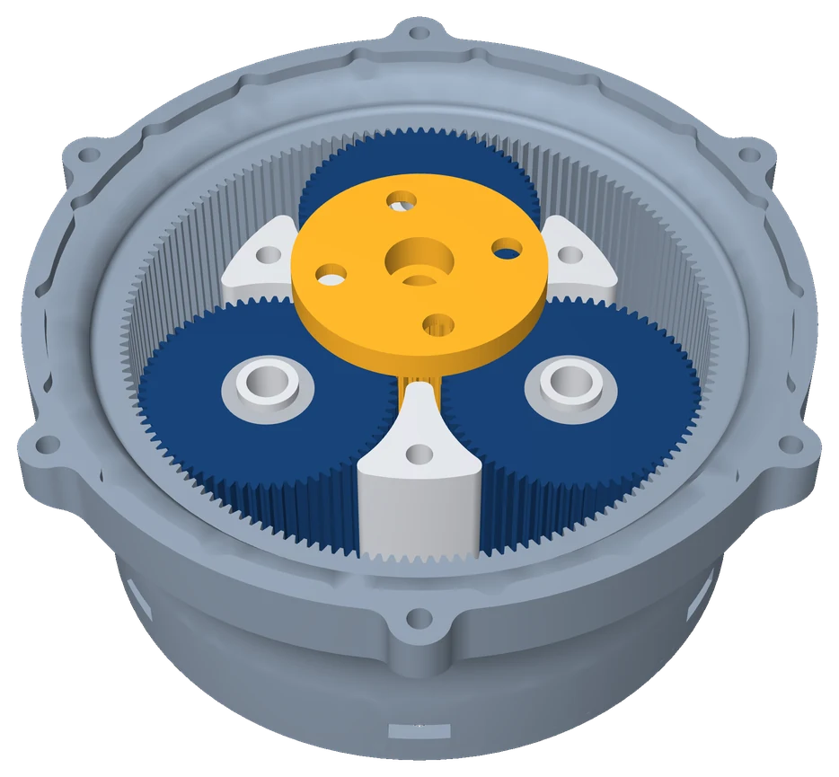
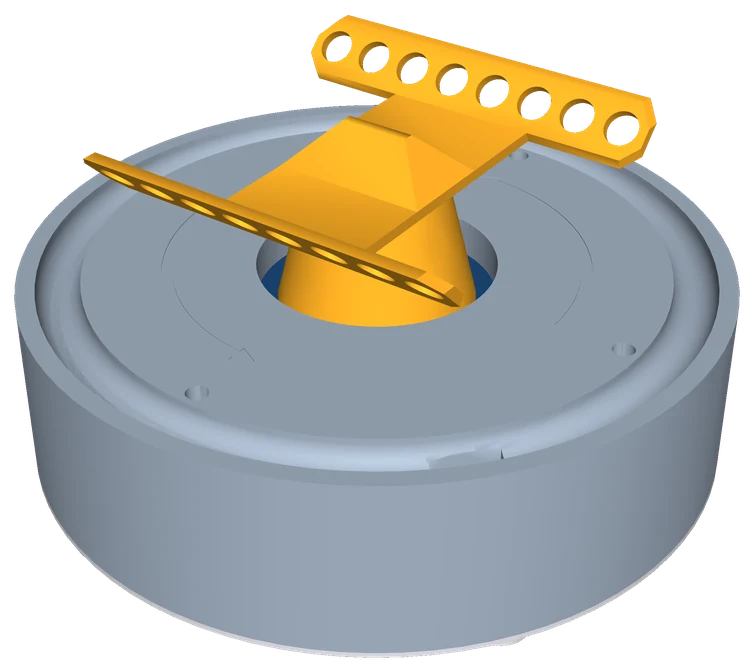

<p align="center">
  
</p>

<h1 align="center">cad-reverse-engineer</h1>

<p align="center">
  <b>Turn a paper, patent or datasheet into parametric CAD, with every dimension traced to where it came from.</b>
</p>

<p align="center">
  <a href="#try-it">Try it</a> ·
  <a href="#three-skills">Three skills</a> ·
  <a href="#how-it-works">How it works</a> ·
  <a href="#examples">Examples</a> ·
  <a href="#install">Install</a>
</p>

<p align="center">
  
  <br>
  <sub>The COMPAct 7.2:1 gearbox in <a href="examples/compact-sspg"><code>examples/compact-sspg</code></a>, rebuilt from the paper's tooth counts and held to the authors' STL meshes. Secondary carrier hidden.</sub>
</p>

cad-reverse-engineer is three skills for coding agents, with their CLI, `cadrev`. Give the agent the documents a device was published in, and it builds:

- **CAD you can open and change.** One STEP file per part and one for the assembly, for SolidWorks, Fusion, Onshape or FreeCAD. Behind them is a parametric [build123d](https://github.com/gumyr/build123d) model: every dimension is a named value in `params.yaml`, so you change a number and rebuild.
- **A mechanism that moves.** Joints, gear ratios and lead screws export to MuJoCo, and stated motion is checked on the model: one turn of this gearbox's sun moves its carrier 50°, as its 7.2:1 ratio says.
- **A drawing of each part.** Three views and an isometric one, dimensioned with the values the build was checked against, under an isometric view of the assembly. Screw threads are named from the ISO metric or Unified table and drawn as a drawing shows them; none is cut into the model.
- **A report of where each dimension came from.** It was quoted from a document, probed from a file the authors released, or proposed because nothing states it. Each proposed value is listed beside the question that would settle it.
- **A plan to make it.** How each part is made, what to buy and the assembly sequence, each step under a view of what it places. `cadrev check` holds the plan to the model, so every part and screw it names is one the CAD has, and no part is left in mid-air.

Published hardware rarely comes with CAD you can edit. A paper gives an envelope table and a few labelled figures, a datasheet one drawing, a repository a folder of meshes. A model rebuilt from that mixes stated values with guesses, and once the STEP file exists, nobody can tell which is which. This keeps them apart, and checks the built geometry against every value the sources state.

## Try it

With [uv](https://docs.astral.sh/uv/) installed, rebuild the benchtop centrifuge from its paper and the authors' STEP files:

```
git clone https://github.com/Vini-41/cad-reverse-engineer
cd cad-reverse-engineer
scripts/cadrev check examples/centrifuge
```

```
building model.py
evaluating checks.yaml
wrote build/parts/body.step
...
wrote build/assembly.step
wrote build/drawings/: 6 part drawings
wrote build/isometric.png

VERIFIED: 0 errors, 1 warning, 88/88 checks pass. Report: build/report.md
```

The first run downloads build123d, OCC and MuJoCo (about a minute); the check itself takes about 15 seconds. Open `examples/centrifuge/build/assembly.step` in your CAD program, then read `build/report.md` beside it. It opens:

> **VERIFIED**: 0 errors, 1 warning. 88/88 geometry checks pass.\
> Of 92 parameters, 86 rest on sources, 0 on measured values and 6 on proposed values.

The warning names what nothing holds: the fan's motor is not built, so its hub and the rotor on it stand 2 mm clear of the plate. After its sources, the report lists what they leave open:

| gap | question | close by | params |
|---|---|---|---|
| G-fan | What are the 80 mm fan's thickness, blade-bore diameter and screw-hole layout (AKYGA AW-8A-BK datasheet)? | datasheet | fan_t, fan_bore_d, fan_rot |
| G-seat | Is the fan's hub flush with its frame's top face, so that the rotor's hub ledge sits level with the deck underside? | measure | fan_top_y, rotor_seat_y |
| G-pla | What does the PLA used for the rotor weigh per cm³ as printed? | measure | pla_density |

Below that come the parts, each with its drawing above the checks that read it, and then every parameter and quote as a table row you can audit against the paper.

<p align="center">
  
  <br>
  <sub><code>build/drawings/body.png</code>: each dimension is a check, printed at the value the body was built to.</sub>
</p>

## Three skills

Each does one job, and each builds on the one before.

- **`known-first`** builds and checks only the parts whose every dimension the documents settle. Every other part waits, with the question that would settle it. It guesses nothing.
- **`complete-model`** builds the whole object. It asks three things first: metric or US, the material, and whether to follow the design or the function. Then it proposes what the documents leave open, each value beside its question and each chosen to be made: a thread from the ISO metric or Unified table, a screw in a length you can buy, one screw size before two.
- **`ask-machinist`** reviews the model as the person who has to make it, part by part, thumbs up or thumbs down. Then it writes the plan: how each part is made, what to buy, and the assembly sequence.

Name the skill you want, or ask for the CAD. *"Reverse-engineer the gripper in this paper"* gets you the complete model.

## How it works

A reconstruction is a directory of plain files, and `cadrev check` holds them to each other:

```
 project.yaml  evidence.yaml   params.yaml      model.py     checks.yaml     report.md
 ┌─────────┐    ┌─────────┐    ┌─────────┐    ┌─────────┐    ┌─────────┐    ┌─────────┐
 │ Sources │ ─▶ │ Ledger  │ ─▶ │ Params  │ ─▶ │  Model  │ ─▶ │ Checks  │ ─▶ │ Report  │
 └─────────┘    └────┬────┘    └─────────┘    └─────────┘    └────▲────┘    └─────────┘
                     └─── compared with the ledger, not params ───┘
```

1. **Ledger.** Every number the sources state about the object is recorded as a verbatim quote, located in a hash-pinned copy of the source. A number printed only inside a figure is a crop of that figure, with a reading a person confirms. Geometry the authors released (STEP, STL, laser-cut SVG) is probed: its dimensions are read from the file itself.
2. **Parameters.** The model takes every number from `params.yaml`, where each declares its basis: `source`, `derived`, `measured` or `proposed`. `model.py` is linted to hold no dimensions of its own.
3. **Checks.** Each published value (an envelope, a hole pitch, a bore, a mass, a gear ratio, a stroke) is evaluated on the built solids and compared with the ledger, never with the parameters. A part whose file the authors released is also compared with it, surface to surface.
4. **Report.** `build/report.md` gives the status, the questions that would replace each proposed value, the conflicts between sources, and then the full audit trail, its checks part by part under each part's drawing. Once the design has a plan, `build/plan.md` is its guide: what to make, what to buy and each step under its view, with each quantity counted from the model.

VERIFIED means every number is accounted for and the geometry matches every checked source value. It does not mean the sources settle everything: what they leave open stays listed as proposed, so the report never claims more than the evidence supports. A number read off a figure holds the status at VERIFIED PENDING REVIEW until a named person confirms the reading.

## Examples

<table>
<tr>
<td width="230"><a href="examples/centrifuge"></a></td>
<td><b><a href="examples/centrifuge">Benchtop centrifuge</a></b><br><sub>Poór, <a href="https://doi.org/10.1016/j.ohx.2022.e00328"><i>HardwareX</i> 2022</a></sub><br><br>Printed parts with their switch and fan cut-outs, rebuilt from the authors' STEP files. 86 of its 92 parameters rest on sources; the other six wait on the fan's datasheet and the print density. The quickest to run: 15 seconds.</td>
</tr>
<tr>
<td><a href="examples/compact-sspg"></a></td>
<td><b><a href="examples/compact-sspg">COMPAct 7.2:1 gearbox</a></b><br><sub>Singh et al., <a href="https://arxiv.org/abs/2510.07197">arXiv 2025</a></sub><br><br>A planetary gearbox for a robot actuator. Its gears are built from the paper's tooth counts and module, its ratio is checked in motion, and all six parts are held to the authors' STL meshes.</td>
</tr>
<tr>
<td><a href="examples/cell-stretcher"></a></td>
<td><b><a href="examples/cell-stretcher">Cell stretcher</a></b><br><sub>Kah et al., <a href="https://doi.org/10.1016/j.ohx.2020.e00162"><i>HardwareX</i> 2021</a></sub><br><br>A stepper-driven stage of laser-cut acrylic. Both lead screws are checked at the stated 8 mm per turn. The paper prints no plate dimensions, so the report names 138 of its 170 parameters as proposed, and each plate's outline is still held to the authors' cut sheets.</td>
</tr>
</table>

A fresh agent built each one from the skill and its sources alone; the [benchmark](docs/benchmark.md) compares how Anthropic's and OpenAI's frontier models do at that. Every example's sources are committed, so each runs from a fresh clone, and `scripts/check` holds it to the status its README states.

## Install

The skills are built for Fable 5.2, and run in Claude Code, Codex and any agent that reads skills.

<details open>
<summary><b>Claude Code</b></summary>

```
/plugin marketplace add Vini-41/cad-reverse-engineer
/plugin install cad-reverse-engineer@cad-reverse-engineer
```

</details>

<details>
<summary><b>Codex</b></summary>

```
codex plugin marketplace add Vini-41/cad-reverse-engineer
codex plugin add cad-reverse-engineer@cad-reverse-engineer
```

Codex's default sandbox blocks network access, which the CLI needs to download its dependencies. Allow it in `~/.codex/config.toml`:

```toml
[sandbox_workspace_write]
network_access = true
```

</details>

<details>
<summary><b>Any agent that reads skills</b></summary>

```
npx skills add Vini-41/cad-reverse-engineer --skill '*'
```

Install all three: `complete-model` and `ask-machinist` use the CLI that `known-first` holds.

</details>

<details>
<summary><b>The CLI alone</b></summary>

```bash
git clone https://github.com/Vini-41/cad-reverse-engineer
alias cadrev="$PWD/cad-reverse-engineer/plugin/skills/known-first/cadrev"
cadrev init my-project
cadrev source my-project paper.pdf --id paper --kind paper --citation "Doe et al. 2026"
cadrev text my-project paper --page 4      # the exact text quotes are matched against
cadrev figures my-project paper            # render each page, extract each figure
cadrev crop my-project figures/paper/p004_01.jpg 850 160 1240 385 --name fig2a --zoom 2
cadrev check my-project                    # every rule and check; writes build/
```

</details>

Then give the agent your documents and ask, as [Three skills](#three-skills) says.

The CLI runs on your machine and needs [uv](https://docs.astral.sh/uv/), with Python 3.12 to 3.14, which uv can install. The plugin ships from [`plugin/`](plugin): the three skills, the CLI's source and lockfile, and nothing else of this repo.

## Development

`scripts/check` is the repo's one check, run locally and by GitHub Actions on every pull request: ruff, pyright and the tests, which run every example. [`GLOSSARY.md`](GLOSSARY.md) defines the terms the skills, the CLI and its findings use.

To report a problem, open an issue with the command you ran, the finding it printed, and the project directory or the paper.

## License

The code is under the MIT license. Each example's sources and figure crops keep the license and credit its README names: CC BY 4.0 for the articles and their files, MIT for COMPAct's STL.
