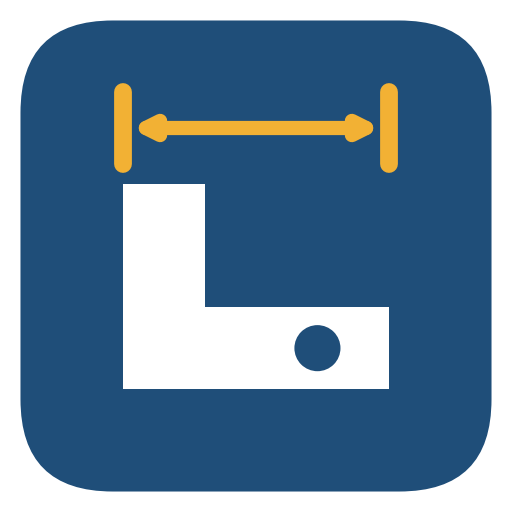

<p align="center">
  
</p>

<h1 align="center">cad-reverse-engineer</h1>

<p align="center">
  <b>Rebuild published hardware as CAD that anyone can audit, number by number, against the paper.</b>
</p>

<p align="center">
  <a href="#install">Install</a> ·
  <a href="#how-it-works">How it works</a> ·
  <a href="#examples">Examples</a> ·
  <a href="docs/benchmark.md">Benchmark</a> ·
  <a href="CHANGELOG.md">Changelog</a>
</p>

<p align="center">
  
  <br>
  <sub>The COMPAct 7.2:1 gearbox in <a href="examples/compact-sspg"><code>examples/compact-sspg</code></a>: gears built from the paper's tooth counts, every part shape-checked against the authors' STL. Rendered from its <code>build/model.mjcf</code>, secondary carrier hidden.</sub>
</p>

cad-reverse-engineer is a skill for coding agents, with its CLI, `cadrev`. Built for Fable 5.2 and [benchmarked](docs/benchmark.md) across Anthropic's and OpenAI's frontier models, it runs in Claude Code, Codex and any agent that reads skills.

Papers rarely ship CAD. They give an envelope table in the supplement, a few labelled dimensions in a figure, a kinematic length in the methods, and part numbers for the servos. A reconstruction built from that mixes stated values with guesses, and once the STEP file exists, nobody can tell which number is which.

## How it works

This project keeps that boundary visible and machine-checked. Each step is a file in the project directory, and `cadrev check` holds them to each other:

```
 project.yaml  evidence.yaml   params.yaml      model.py     checks.yaml     report.md
 ┌─────────┐    ┌─────────┐    ┌─────────┐    ┌─────────┐    ┌─────────┐    ┌─────────┐
 │ Sources │ ─▶ │ Ledger  │ ─▶ │ Params  │ ─▶ │  Model  │ ─▶ │ Checks  │ ─▶ │ Report  │
 └─────────┘    └────┬────┘    └─────────┘    └─────────┘    └────▲────┘    └─────────┘
                     └─── compared with the ledger, not params ───┘
```

1. **Ledger.** Every number a source states about the object is recorded as a verbatim quote, located in a SHA-256-pinned copy of the source. Numbers printed only inside figures are recorded as hashed image crops with a human-confirmed reading. Geometry the authors released (STEP, STL, laser-cut SVG) is probed rather than quoted.
2. **Parameters.** The model can only get numbers from `params.yaml`, and each parameter declares its basis: `source`, `derived`, `measured` or `proposed`. The model file is linted so that it contains no dimension literals.
3. **Checks.** Published values become geometry checks (envelopes, pin pitches, masses, interference, motion at a stated pose), evaluated on the built solids and compared with the ledger, never with the parameters.
4. **Coverage.** A sweep lists every stated quantity in the sources. Each one is either ledgered or skipped with a reason.
5. **Report.** `build/report.md` states what is verified, which parameters rest on proposed values, which conflicts between sources are still open, and which questions to send the authors.

```
$ cadrev check examples/legclaw-links
wrote build/parts/compression_linkage.step
...
VERIFIED: 0 errors, 2 warnings, 10/10 checks pass. Report: build/report.md
```

`build/report.md` opens:

> **VERIFIED**: 0 errors, 2 warnings. 10/10 geometry checks pass.\
> Of 15 parameters, 9 rest on sources, 0 on measured values and 6 on proposed values.

Here VERIFIED means that every number is accounted for and the geometry realises every checked source value. Anything the sources leave open stays listed as proposed, so the report never claims more than the evidence supports. A number read off a figure crop holds the status at VERIFIED PENDING REVIEW until a named reviewer confirms that reading; the example's Fig. 2A label has been confirmed.

`cadrev check` writes `build/`:

- `parts/*.step`: one STEP file per part.
- `assembly.step`: the assembly, with labelled instances.
- `model.mjcf`: the mechanism for MuJoCo, when the model declares joints.
- `overlays/*.png`: model edges drawn over figures.
- `report.md` and `report.json`: the verification report.

## Two ways to build

The agent asks which you want before it starts:

- **The complete model.** Every part is built. Each value the sources leave open is proposed, beside the question that would settle it.
- **Known first.** Only the parts the sources settle completely are built and checked. The rest wait, each with its question, until you build on the model yourself or have the agent propose the rest.

## Install

<details open>
<summary><b>Claude Code</b></summary>

```
/plugin marketplace add Vini-41/cad-reverse-engineer
/plugin install cad-reverse-engineer@cad-reverse-engineer
```

</details>

<details>
<summary><b>Codex</b></summary>

```
codex plugin marketplace add Vini-41/cad-reverse-engineer
codex plugin add cad-reverse-engineer@cad-reverse-engineer
```

Codex's default sandbox blocks network access, which the CLI needs to download its dependencies. Allow it in `~/.codex/config.toml`:

```toml
[sandbox_workspace_write]
network_access = true
```

</details>

<details>
<summary><b>Any agent that reads skills</b></summary>

```
npx skills add Vini-41/cad-reverse-engineer
```

</details>

<details>
<summary><b>Standalone CLI</b></summary>

```bash
git clone https://github.com/Vini-41/cad-reverse-engineer
alias cadrev="$PWD/cad-reverse-engineer/plugin/skills/cad-reverse-engineer/cadrev"
cadrev init my-project
cadrev source my-project paper.pdf --id paper --kind paper --citation "Doe et al. 2026"
cadrev text my-project paper --page 4      # the exact text quotes are matched against
cadrev figures my-project paper            # render each page, extract each figure
cadrev crop my-project figures/paper/p004_01.jpg 850 160 1240 385 --name fig2a --zoom 2
cadrev coverage my-project                 # stated quantities not yet ledgered or skipped
cadrev check my-project                    # everything; writes build/
```

</details>

Then ask the agent something like *"reverse-engineer the gripper in this paper as CAD"*, or invoke `/cad-reverse-engineer` in Claude Code. The skill takes the agent through nine stages: scope, sources, ledger, released geometry, parameters, model, checks, motion and hand-over. Each ends on a criterion the CLI can confirm.

The CLI runs locally and needs [uv](https://docs.astral.sh/uv/), with Python 3.12 to 3.14. Its first run downloads build123d, OCC and MuJoCo from PyPI (about a minute), at the versions in the lockfile. The plugin ships from [`plugin/`](plugin): the skill, its CLI's source and lockfile, and nothing else of this repo.

## Examples

| Example | What it shows |
|---|---|
| [LegClaw&nbsp;linkages](examples/legclaw-links)<br><sub>Cheng&nbsp;et&nbsp;al., [*Advanced&nbsp;Science*&nbsp;2026](https://doi.org/10.1002/advs.202523518)</sub> | Each kind of evidence: supplement tables, methods quotes, a figure-label crop, two source conflicts, and proposed pin pitches with the questions that would settle them |
| [LegClaw](examples/legclaw)<br><sub>the&nbsp;same&nbsp;sources</sub> | The full leg-claw with its motion: four-bars, servos and the cables that close the claws, exported to MuJoCo |
| [Benchtop&nbsp;centrifuge](examples/centrifuge)<br><sub>Soma&nbsp;Poór, [*HardwareX*&nbsp;2022](https://doi.org/10.1016/j.ohx.2022.e00328)</sub> | A static project checked against the authors' released STEP files |
| [Cell&nbsp;stretcher](examples/cell-stretcher)<br><sub>Kah&nbsp;et&nbsp;al., [*HardwareX*&nbsp;2021](https://doi.org/10.1016/j.ohx.2020.e00162)</sub> | Two lead screws driving one carriage, checked against the authors' laser-cut SVG sheets and STL |
| [COMPAct&nbsp;7.2:1&nbsp;gearbox](examples/compact-sspg)<br><sub>Singh&nbsp;et&nbsp;al., [arXiv&nbsp;2025](https://arxiv.org/abs/2510.07197)</sub> | A planetary train checked from its tooth counts and against the authors' STL |

The LegClaw linkages are small by design; fresh agents built the other four from the skill and the sources alone. Every example's sources are committed, so `cadrev check examples/<name>` runs from a fresh clone, and `scripts/check` holds each one to the status its README states.

## Repository layout

```
plugin/                    the plugin, as it installs
  .claude-plugin/          its Claude Code manifest
  .codex-plugin/           its Codex manifest
  skills/cad-reverse-engineer/
    SKILL.md               the work, stage by stage
    references/            project file formats; the model contract
    cadrev                 runs the CLI from any directory
    tool/                  the cadrev Python package and its lockfile
.claude-plugin/            the Claude Code marketplace
.agents/plugins/           the Codex marketplace
skills.sh.json             where npx skills finds the skill
examples/                  worked reconstructions, with their sources
tests/                     the cadrev tests, which run every example
docs/adr/                  the decisions behind the rules
docs/benchmark.md          how far a fresh agent gets, by model
GLOSSARY.md                the terms the skill, the CLI and its findings use
scripts/check              the repo's only CI, run locally
```

## Development

`scripts/check` is the repo's only CI, run locally before every merge: ruff, pyright and the tests, which run every example. `scripts/check --lint` runs the first two alone. The tests drive the CLI as an agent does:

```bash
cd plugin/skills/cad-reverse-engineer/tool
uv run --extra test pytest -q -n auto ../../../../tests -m "not slow"   # without the examples
```

To report a problem, open an issue with the command you ran, the finding it printed, and the project directory or the paper.

## License

The code is under the MIT license. Each example's sources and figure crops keep the license and credit its README names: CC BY 4.0 for the articles and their files, MIT for COMPAct's STL.
