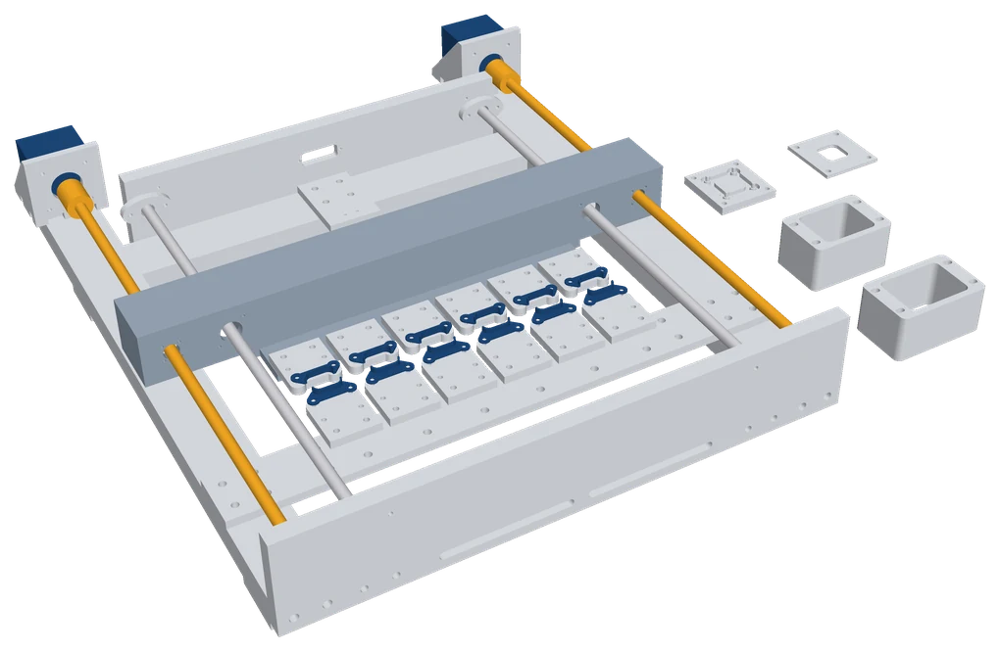

# Uniaxial cell stretcher



A six-well stretching stage of laser-cut acrylic, from Kah et al., *A low-cost uniaxial cell stretcher for six parallel wells*, HardwareX 9 (2021) e00162. [doi:10.1016/j.ohx.2020.e00162](https://doi.org/10.1016/j.ohx.2020.e00162). CC BY 4.0. Its laser-cut SVG sheets and STL files are on Mendeley Data, [doi:10.17632/mgkbmytx63.1](https://doi.org/10.17632/mgkbmytx63.1), also CC BY 4.0.

```
scripts/cadrev check examples/cell-stretcher
```

Expected status: `VERIFIED: 0 errors, 0 warnings, 119/119 checks pass`

It takes about 20 seconds. Then open `build/assembly.step` in a CAD program and read `build/report.md`. The mechanism is in `build/model.mjcf`, for MuJoCo.

## What it shows

A lead-screw stage whose sources hold shapes but few dimensions. A fresh agent reconstructed it from the skill and these sources alone: the stretcher unit with its 3D-printed clamps, and the mould its PDMS substrates are cast in. The electronics and controller unit is left out.

- **The lead screws are checked in motion.** Two stepper motors each turn their own screw, and both move one carriage. One turn of either moves it the stated "8 mm per revolution", and a third check works the same lead out from the stated top speed and motor speed. The carriage's range is 25 mm, Table 2's largest tested amplitude.
- **Cut sheets are sources.** Every region of `Acryl6MM.svg` (54) and the mould's regions of `Acryl3MM.svg` is compared, outline to outline, with the plate the model builds. The controller housing's regions are skipped with a reason.
- **Proposed values are named, then held to the shape.** The paper prints no plate dimensions, so 138 of the 170 parameters are proposed, under ten gaps for the authors and the datasheets. The plates built from them still have to match the cut sheets, most within 0.05 mm.
- **The printed parts are compared with their meshes.** `Clamp.stl` and `MoldFrame.stl` are shape-checked against the built clamp and mould frame, and probed for their dimensions.

No figure reading is needed, so no reviewer confirms one.

`gen_cutfile.py` writes `evidence.yaml` and `checks.yaml` from the hand-written `evidence.src.yaml` and `checks.src.yaml`, adding a shape check and its sheet datums for each cut-file region a part reproduces; edit the `.src.yaml` files and rerun it (`../../scripts/cadrev python -I gen_cutfile.py`) rather than editing those two files.

## Sources

The paper, both SVG sheets and both STL are committed, so a fresh clone needs no download.
