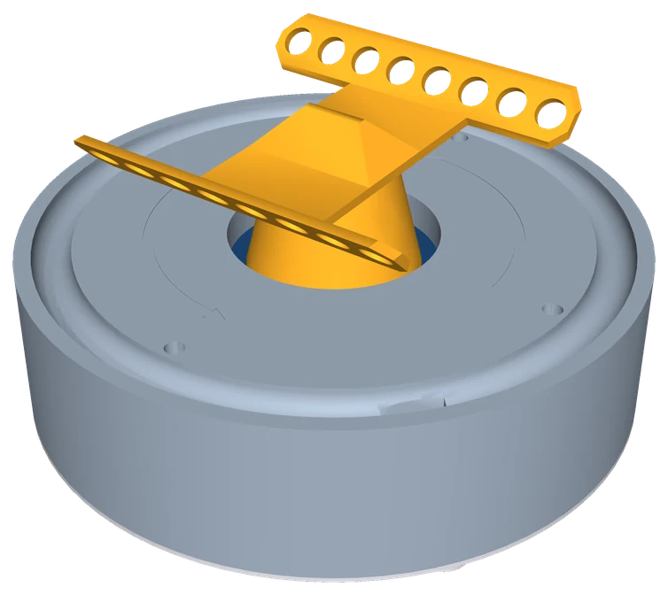

# Mini benchtop centrifuge



A 3D-printed centrifuge built around an 80 mm computer fan, from Soma Poór, *A low-cost and open-source mini benchtop centrifuge for molecular biology labs*, HardwareX 12 (2022) e00328. [doi:10.1016/j.ohx.2022.e00328](https://doi.org/10.1016/j.ohx.2022.e00328). CC BY 4.0. Its STEP and STL files are on Mendeley Data, [doi:10.17632/sy2vrhj227.1](https://doi.org/10.17632/sy2vrhj227.1), also CC BY 4.0.

```
scripts/cadrev check examples/centrifuge
```

Expected status: `VERIFIED: 0 errors, 1 warning, 88/88 checks pass`

It takes about 15 seconds. Then open `build/assembly.step` in a CAD program and read `build/report.md`.

## What it shows

A static assembly whose authors released STEP files. A fresh agent reconstructed it from the skill and these sources alone: the body, the bottom plate, the PCR-strip rotor for the 32.5 mm fan hub, the 80 mm fan as a frame and hub, and the four M3 screws.

- **Dimensions come from the authors' files.** 74 probes read the body, the plate and the rotor: a bore's diameter, a hole pitch, a cut-out's corner. 86 of the model's 92 parameters rest on sources: these probes and the paper's quotes.
- **Each built part is compared with the released one.** Three shape checks hold the body, plate and rotor to their STEP bodies, surface to surface.
- **What is not built says why.** Ten released bodies are skipped with a reason: the variants not chosen, two fit testers, an arrow inlay and the tube adapters.
- **A stated mass is checked.** The rotor weighs 16.02 g against the paper's 16 g, and the report says that check rests on a proposed PLA density.
- **Sources that disagree are recorded.** The parts list gives the rocker switch as 19 × 12.5 mm and the body's cut-out for it is 19 × 13 mm: one of three conflicts, each with its resolution.
- **What nothing holds is named.** The fan's motor is not built, so its hub and the rotor pressed onto it stand 2 mm clear of the plate, on nothing: the run's one warning. Each screw is held across the fit its boss leaves, which project.yaml names as the `clearance`.
- **What the sources leave open is a question.** Six parameters are proposed, under three gaps: the fan's datasheet, how the fan seats, and the density of the print.

One number exists only in a figure: Fig. 8's Cura object list, held as the hashed crop `figures/crops/fig8-body-dims.png`. A named reviewer checked the reading against the crop, recorded as `confirmed_by` on `fig8-body-dims` in `evidence.yaml`.

`gen_ledger.py` writes `evidence.yaml`, `params.yaml`, `checks.yaml` and `gaps.yaml`, reading `skips.json`; edit it and rerun it (`python3 gen_ledger.py`) rather than editing those files.

## Sources

The paper and the twelve STEP files are committed, so a fresh clone needs no download. The STL the authors publish beside each STEP file holds the same body and is not registered.

The crop is reproduced from Fig. 8 of the article under CC BY 4.0, credit Soma Poór 2022.
