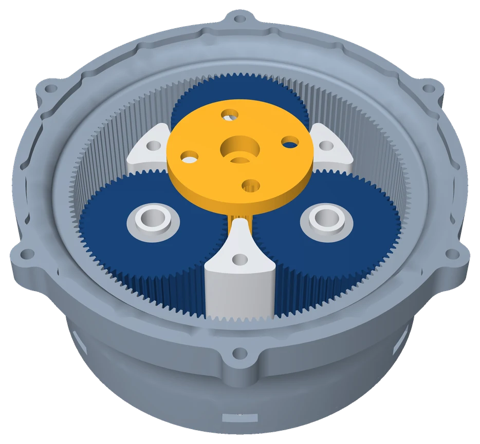

# COMPAct SSPG 7.2:1 gearbox



The single-stage planetary gearbox of the 7.2:1 SSPG actuator from Singh, Kapa, Joshi and Kolathaya, *COMPAct: Computational Optimization and Automated Modular design of Planetary Actuators*, arXiv:2510.07197v2 (2025). [arXiv:2510.07197](https://arxiv.org/abs/2510.07197). CC BY 4.0. Its STL files are in the authors' repository, [github.com/singhaman1750/COMPAct](https://github.com/singhaman1750/COMPAct), `CADs/Actuator_STL_files/sspg_7.2`, under the MIT licence.

```
scripts/cadrev check examples/compact-sspg
```

Expected status: `NOT VERIFIED: 5 errors, 114 warnings, 11/16 checks pass`

It takes about a minute and a half. Then open `build/assembly.step` in a CAD program and read `build/report.md`. The mechanism is in `build/model.mjcf`, for MuJoCo.

## What it shows

A gear train whose authors released only meshes. A fresh agent reconstructed it from the skill and these sources alone: the sun, three planets, the primary and secondary carriers, the casing with the ring cut inside it, and the output-bearing retainer. The motor and the purchased bearings and bolts are left out.

- **The gears are built from the paper's numbers.** Table I's design vector `[25, 65, 155, 0.5, 3]` gives the sun, planet and ring tooth counts, the module and the number of planets. Each pitch diameter (12.5, 32.5 and 77.5 mm) is checked as module × teeth, and the planets' 22.5 mm centre distance from both the sun and the ring.
- **The ratio is checked in motion.** The ring is fixed, the sun is the input and the carrier the output, as the paper says. One sun turn moves the carrier 50°, checked against 360° over the stated 7.2:1. The train exports to `build/model.mjcf` as joint equalities.
- **Each built part is compared with the released mesh, and five differ from it.** Each part is built where its STL holds it, and its shape check holds the two to 0.001 mm at the points both hold exactly: the mesh's corners, the part's own corners and closed edges, and each facet on one smooth patch of the part. The retainer passes. The gears' flanks are five-point polygons, whose corners lie up to 0.27 mm from the involutes their meshes hold; a casing circle is 0.047 mm off, the secondary carrier 0.42 mm, the carrier 0.08 mm. The parameters read off those five meshes, and the numbers of the frames their parts are built in, stay unchecked until their shape checks pass: 113 of the warnings.
- **The teeth are checked for interference.** The involutes mesh at zero backlash, so the overlap limit is raised to a sliver, 0.001 mm³, and the report lists that limit as non-default.
- **What is not built says why.** Two released bodies are skipped with a reason: the earlier carrier, superseded by the updated one, and the motor casing, outside the target.
- **What nothing holds is named.** The bearings are left out, so the two carriers stand 0.88 mm from the planets, on nothing: the run's last warning. The sun, the planets and the ring hold each other tooth on tooth.
- **What the sources leave open is a question.** 15 of 161 parameters are proposed, under six gaps: the tooth form, the fillet radii, how the parts locate axially.

One reading comes from a figure: Fig. 4(a)'s label "(a) SSPG (MN8014, 7.2:1)", held as the hashed crop `figures/crops/fig4a-label.png`. A named reviewer checked it against the crop, recorded as `confirmed_by` in `evidence.yaml`. It restates the quoted 7.2:1, so it is context.

`checks_gen.py` writes `checks.yaml`: edit it and rerun it (`python3 checks_gen.py`) rather than editing that file.

## Sources

The paper and the eight STL are committed, so a fresh clone needs no download. `sources/LICENSE-COMPAct.txt` is the MIT licence the STL ship under.

The crop is reproduced from Fig. 4 of the article under CC BY 4.0, credit Singh et al. 2025.
