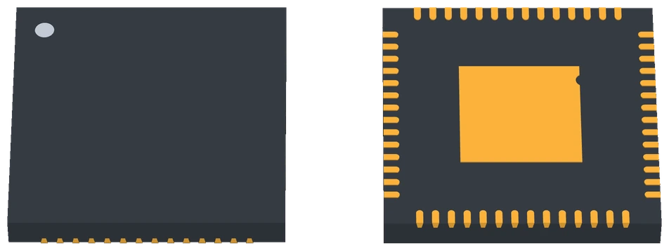

# RP2040 QFN-56 package



The 7×7 mm QFN-56 package of the RP2040 microcontroller, from Raspberry Pi Ltd, [*RP2040 Datasheet*](https://datasheets.raspberrypi.com/rp2040/rp2040-datasheet.pdf), build 4c5ccacb2c2f of 19 November 2026. CC BY-ND 4.0.

```
scripts/cadrev check examples/rp2040-qfn56
```

Expected status: `VERIFIED: 0 errors, 0 warnings, 138/138 checks pass`

It takes about 5 seconds. Then open `build/assembly.step` in a CAD program and read `build/report.md`.

## What it shows

A component rebuilt from its package drawing, taken through `noob` and `build-model` by a fresh agent for each, given the skills and the datasheet alone. No one was there to answer, so the run chose for itself: millimetres, no material, built as designed, and the complete model.

- **It is built in its footprint's frame.** The origin is where the centrelines of Figure 168's land pattern cross, Z = 0 is the board's surface and the package's seating plane, and pin 1 is at −X +Y seen from above. The STEP drops into an ECAD library with no transform.
- **Each stated range is compared as a range.** A, A1, A2, b, D2, E2, L and R are held to the MIN, the MAX or both that Figure 167's table prints. The D, E, e and A3 it states as BSC or REF are compared as single values.
- **A value with no nominal says so.** A1 has only a MIN and a MAX, and R only a MIN. The model builds A1 at the 0.035 the side view draws and R as the half-round the bottom view draws, 0.09, and both rest on proposed values. A has only a MAX of 0.900, and its 0.853 is the stated A2 + A3.
- **Three undimensioned features are scaled off the vector drawing.** They are a lead's top width, A1 as drawn and how far the pad's notch centre lies outside its edge. `measure_fig167.py` reads them against the 0.400 pitch.
- **A conflict is recorded.** Table 633 places the pin 1 dot at X 0.5, Y 6, and Figure 169 draws it near (0.6, 6.4). The model follows the table, and a gap asks what point of the dot the table locates.
- **What the sources leave open is proposed.** Of 34 parameters, 24 rest on the datasheet, 3 on measured values and 7 on proposed values, under 8 gaps. The tie-bar ends, the marking's logo and text, and the plating are not built.

The run ended at VERIFIED PENDING REVIEW. A named reviewer then checked its 27 figure readings against their crops in `figures/crops/`, recorded as `confirmed_by` in `evidence.yaml`, which makes it VERIFIED.

## Sources

The datasheet is committed unmodified, so a fresh clone needs no download. The crops are excerpts of its Figures 3, 167, 168, 169 and 171, © Raspberry Pi Ltd, under [CC BY-ND 4.0](https://creativecommons.org/licenses/by-nd/4.0/).
